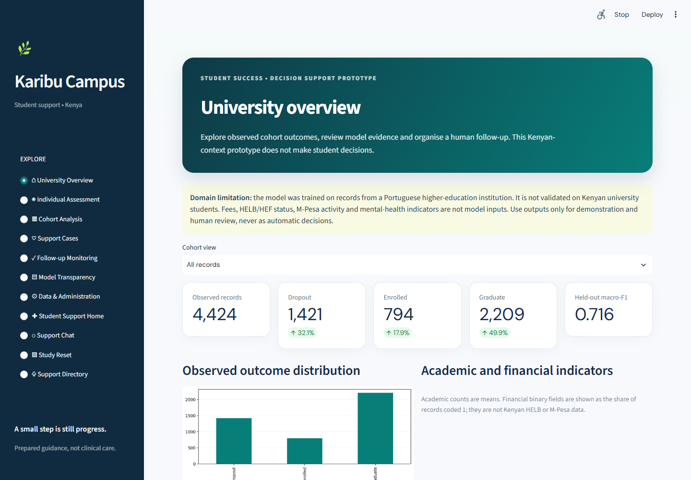

# Karibu Campus: Student Support and Academic Outcome Prototype

Course project for CPP 4201, KCA University. The repository combines two separate components: a reproducible model pipeline for the public UCI student-outcome dataset and a Kenyan university campus support prototype. The model dataset comes from a Portuguese institution; its estimates are not validated for Kenyan universities. The app is not clinical care, an operational early-warning system or an automated decision service.

## Features

- **Student support hub:** Kenyan-campus entry page, optional session-only check-in, intent-based chat, study-reset planner and support directory.
- **Eleven Streamlit views:** Home, Individual Assessment, Cohort Analysis, Support Cases, Follow-up Monitoring, Model Transparency, Data & Administration, Student Support Home, Support Chat, Study Reset and Support Directory.
- **Model-backed assessment:** a fitted scikit-learn Pipeline is saved locally and used for a clearly synthetic profile. Adjustable probability review bands are provisional and require human review.
- **Case-workflow demonstration:** pseudonymous local JSON records can be created, updated and monitored. This has no authentication or production security; do not use real student records.
- **Reproducible analysis:** extraction and validation, preprocessing inside cross-validation, comparison of three classifiers, held-out evaluation and saved artifacts.

The chatbot uses deterministic regular-expression intent routing and prepared replies, not an LLM. It covers academic/exam pressure, fees/HELB, anxiety/worry, loneliness, low mood, greetings and immediate-safety signposting. It does not diagnose or monitor messages.

## Preview



The app keeps outcome modelling separate from the support chat and resource directory.

## Setup

Requires Python 3.11+. From the repository root:

```bash
python -m pip install -e ".[dev,report,app]"
python -m dropout_pipeline.cli --download
python -m streamlit run src/dropout_pipeline/support_app.py
```

Open the local URL printed by Streamlit, normally `http://localhost:8501`. To use an existing CSV instead of downloading:

```bash
python -m dropout_pipeline.cli --data data/raw/data.csv
```

The first modelling run downloads the official UCI archive, validates the data, compares the three classifiers using stratified five-fold cross-validation and evaluates the selected model once on a held-out test partition. It saves the trained model and report artifacts in `outputs/`. Downloaded data and generated outputs are ignored by Git; run the pipeline to reproduce them. See [data provenance](data/raw/README.md) and [artifact notes](outputs/README.md).

## Evaluation snapshot

The reported experiment uses the public UCI student-outcomes dataset from a Portuguese institution. It reserves 885 records for a stratified held-out evaluation after five-fold cross-validation on the training partition.

| Measure | Result |
|---|---:|
| Mean training CV macro-F1 | 0.705 (SD 0.030) |
| Held-out macro-F1 | 0.716 |
| Held-out accuracy | 0.756 |

The `Enrolled` class is the weakest by F1 (0.526). Semester performance features rank highest in permutation analysis; their timing may be too late for an early-warning use case. These results describe one split of one dataset, not performance on Kenyan university students.

## GitHub Codespaces

Install the dependencies above in a Codespaces terminal, then run:

```bash
python -m streamlit run src/dropout_pipeline/support_app.py --server.address 0.0.0.0 --server.port 8501
```

Open the forwarded port `8501` in the Codespaces **Ports** panel. To enable model assessment and analytics, prepare artifacts with `python -m dropout_pipeline.cli --download` in another terminal and refresh the app.

## Development checks

```bash
python -m pytest
ruff check .
ruff format --check .
mypy src/
```

## Documentation

- [Step-by-step setup and demo guide](docs/demo_guide.md)
- [Demo guide](docs/demo_guide.md), [methodology](docs/methodology.md), and [project design](docs/project_design.md)
- App screenshots are under `docs/report/screenshots/`.
- [Concept map](docs/concept_map.md), [methodology](docs/methodology.md), [project design](docs/project_design.md) and [viva notes](docs/viva_preparation.md)

## Dataset and limitations

The target is the UCI dataset's recorded three-class outcome (`Dropout`, `Enrolled`, `Graduate`). A held-out result describes performance on a random test partition from that dataset, not prediction for a Kenyan campus. Semester features may be recorded too late to support early intervention. The student-support content is generic signposting and must be checked against current campus referral routes and provider details. Do not enter personal or sensitive student data into the prototype.

## Course context

KCA University · CPP 4201 · Advanced Python Programming
